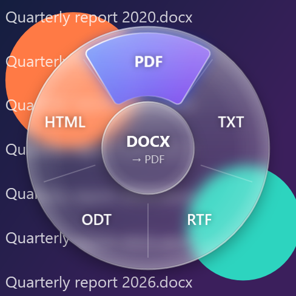
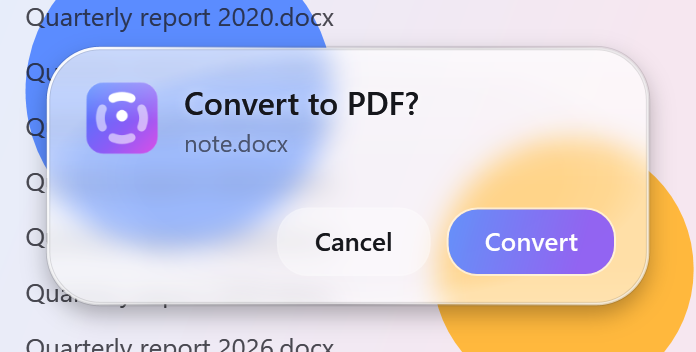

# Radial Convert

Select a file on the Desktop or in File Explorer, **hold Ctrl**, drag the mouse toward a format
on the glass ring that appears, and **let go**. Confirm on the card that pops up and the converted
file appears next to the original (`report.pdf`, or `report (1).pdf` if that already exists).

```
hold Ctrl ─► read selection ─► glass ring at cursor ─► drag to a format ─► release ─► confirm ─► convert ─► notify
```

<p>
  
  
</p>

## Download / install

`dist\RadialConvert.exe` is a single self-contained exe (about 72 MB) for 64-bit Windows 10/11; there's
nothing to install, not even .NET. Copy it anywhere and run it. A tray icon appears; right-click it
for enable/disable, *Convert a file…*, *Start with Windows*, the log, and Exit.

The exe is not code-signed yet, so SmartScreen may say "Windows protected your PC" the first
time; choose *More info → Run anyway*. Some antivirus tools are wary of unsigned apps with a
keyboard hook; the app only watches the Ctrl key and never records keystrokes.

To rebuild it: `powershell -ExecutionPolicy Bypass -File publish.ps1`

## Develop

Requires the .NET 10 SDK. Office conversions need Microsoft Office installed.

```bash
dotnet build
dotnet run --project src/RadialConvert
```

**How the gesture works.** After Ctrl has been held on its own for 0.3 s the ring appears around
the cursor. The format in the direction you move the mouse is highlighted; releasing Ctrl while
the cursor is still in the centre cancels. Pressing any other key, clicking or scrolling while
Ctrl is down (Ctrl+C, Ctrl+click, Ctrl+scroll) cancels too, so normal shortcuts keep working.
On the confirm card, Enter/Convert continues and Esc/Cancel/clicking elsewhere backs out.

**The glass.** Layered windows can't use Windows' acrylic, so the ring grabs a snapshot of the
screen behind it, then blurs, magnifies and tints it with a specular rim. Text switches between
light and dark depending on what's underneath.

## Supported conversions

| From | To | Engine |
|---|---|---|
| DOC, DOCX, RTF, ODT, TXT | PDF, DOCX, TXT, RTF, ODT, HTML | Microsoft Word |
| PDF | DOCX, TXT, RTF | Microsoft Word (PDF Reflow; layout is best-effort) |
| PNG, JPG, BMP, GIF, TIFF | PDF | Microsoft Word |
| XLS, XLSX, XLSM, XLSB, CSV, ODS | PDF, XLSX, CSV (UTF-8), ODS, XLS | Microsoft Excel |
| PPT, PPTX, PPSX, ODP | PDF, PPTX, ODP, PNG/JPG per slide (folder) | Microsoft PowerPoint |
| PNG, JPG, BMP, GIF, TIFF, ICO, WEBP*, HEIC* | PNG, JPG, BMP, TIFF, GIF | Windows Imaging Component |

\* WEBP/HEIC need the matching codec from the Microsoft Store. Selecting several files shows only
the options that apply to all of them, and converts each one.

## Command line (handy for testing)

```bash
RadialConvert --list "C:\path\report.docx"
RadialConvert --convert "C:\path\report.docx" pdf
RadialConvert --selection
RadialConvert --preview-menu "C:\path\report.docx" menu.png 0 dark
RadialConvert --preview-confirm "C:\path\report.docx" pdf card.png light
```

`--selection` reads whatever is selected in the foreground Explorer window; the preview commands
render the ring (with option 0 highlighted) or the confirm card over a sample wallpaper.

## Project layout

```
src/RadialConvert/
  Program.cs                    entry point, single instance, command line
  TrayApp.cs                    tray icon and the hold → menu → release → confirm → convert flow
  Input/CtrlHoldDetector.cs     low-level keyboard/mouse hooks, Ctrl-hold rules
  Shell/ExplorerSelection.cs    selected files from Explorer (incl. Win11 tabs) and the Desktop
  UI/Glass.cs                   screen capture + the liquid glass layers
  UI/GlassWindow.cs             shared overlay window: DPI-aware placement, open/close animation
  UI/RadialMenuWindow.cs        the ring; direction-based selection with a gliding highlight
  UI/ConfirmWindow.cs           the "Convert to PDF?" card
  Assets/                       logo.ico, logo PNGs (generated by tools/LogoGen)
  Conversion/
    Conversion.cs               ConversionOption, IConverter, registry, output naming
    ConversionService.cs        one-at-a-time background STA worker
    OfficeConverters.cs         Word / Excel / PowerPoint via COM, with a 2-minute watchdog
    PdfNoticeConfirmer.cs       presses OK on Word's "will now convert your PDF" notice
    ImageConverter.cs           image formats via WIC
```

## Notes and limits

- Office runs hidden; for PDF input Word runs minimized because its PDF conversion notice
  ignores `DisplayAlerts`. The notice is matched by its English text, so on a non-English
  Office, PDF→DOCX currently times out (and the watchdog stops that Word instance) instead.
- The watchdog only ever kills an Office process that the conversion itself started.
- Elevated (Run as administrator) Explorer windows can't be read from a normal app.
- The log lives in `%LOCALAPPDATA%\RadialConvert\log.txt`.

## Next steps

- Settings window (trigger: tap / double-tap, output folder, which options appear)
- LibreOffice fallback when Office isn't installed
- Merge several PDFs/images into one PDF, compress PDFs, resize images
- Installer (MSIX / Inno Setup) and code signing
